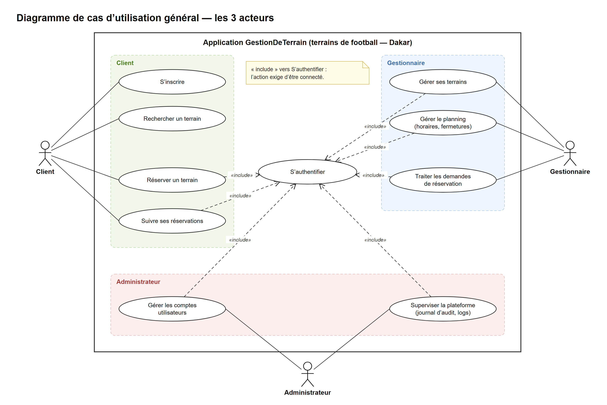
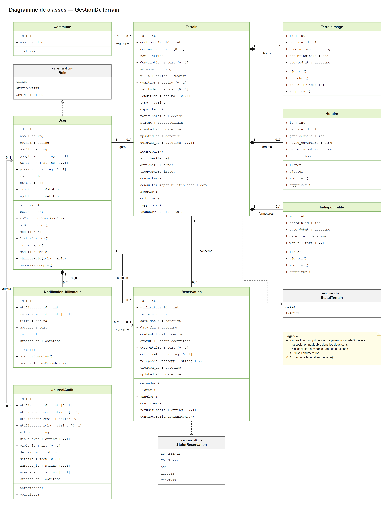
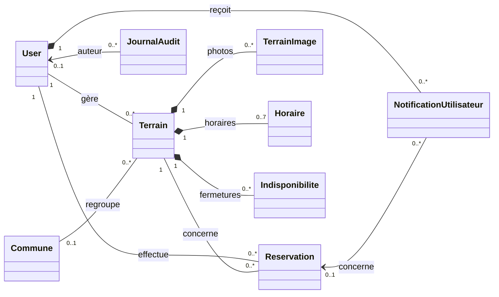

# GestionDeTerrain

Application web de **réservation de terrains de football à Dakar**.

- Les **clients** s'inscrivent avec un formulaire ou **avec Google**, trouvent un terrain sur une liste ou une carte, demandent un créneau et suivent l'itinéraire jusqu'au terrain.
- Les **gestionnaires** reçoivent leurs identifiants de l'administrateur, publient leurs terrains (placement sur la carte, photos, horaires, fermetures), valident ou refusent les demandes (avec un motif) puis conviennent du **paiement sur WhatsApp**. Aucun paiement ne passe par l'application.
- Les **administrateurs** gèrent les comptes et supervisent la plateforme grâce au **journal d'audit** et aux **logs techniques**.

| Couche | Technologies |
| --- | --- |
| Backend (`backend/`) | PHP 8.3+, Laravel 13, Laravel Sanctum (session SPA), MySQL |
| Frontend (`frontend/`) | React 19, Vite 8, React Router 7, Tailwind CSS 4, Leaflet / react-leaflet |
| Services cartographiques | OpenStreetMap (fond de carte, CARTO en secours), Nominatim (adresses), OSRM (itinéraires) |
| Connexion Google | Google Identity Services (bouton « Continuer avec Google », jeton vérifié par le serveur) |

---

## Sommaire

- [Fonctionnalités](#fonctionnalités)
- [Démarrage rapide](#démarrage-rapide)
- [Comptes de démonstration](#comptes-de-démonstration)
- [Configuration](#configuration)
- [Règles métier](#règles-métier)
- [Architecture](#architecture)
- [Tests et qualité](#tests-et-qualité)
- [Dépannage](#dépannage)
- [Documentation détaillée](#documentation-détaillée)

---

## Fonctionnalités

### Visiteur et client (`CLIENT`)

- **Inscription et connexion** sur une seule page : e-mail et mot de passe, ou **« Continuer avec Google »** (option réservée aux clients ; le compte est créé à la première connexion, et un compte existant de même e-mail est relié à Google).
- **Espace client** : après connexion, le client arrive sur l'onglet **Terrains** ; onglets Terrains · Carte · Mes réservations · Mon profil.
- **Accueil** : terrains à la une, fonctionnement en trois étapes.
- **Liste des terrains** : filtres par commune, quartier, revêtement (gazon synthétique, gazon naturel…) et prix ; photos, tarif horaire, capacité.
- **Carte interactive** de Dakar : terrains de la zone visible, « Me localiser », « Suivre ma position ».
- **Itinéraire guidé** depuis sa position, en voiture ou à pied :
  - distance, temps restant et heure d'arrivée mis à jour en continu ;
  - recalcul automatique si l'on quitte le tracé, détection de l'arrivée ;
  - ouverture possible du même trajet dans Google Maps.
- **Fiche d'un terrain** : galerie, informations clés, **emplacement sur une carte**, disponibilité du jour, demande de réservation avec numéro WhatsApp.
- **Mes réservations** : statut de chaque demande, **motif du refus** donné par le gestionnaire, annulation.
- **Notifications** : cloche dans l'en-tête, et message à l'arrivée d'une notification (validation, refus avec motif…).

### Gestionnaire (`GESTIONNAIRE`)

- **Mes terrains** : statistiques (en ligne, hors ligne, demandes en attente), recherche, filtres, alertes (« aucun horaire »).
- **Ajout et modification d'un terrain** avec placement « façon VTC » : repère fixe au centre de la carte, recherche d'adresse, « Ma position ». L'adresse, le quartier et la commune se remplissent automatiquement.
- **Fiche de gestion**, avec quatre onglets :
  - **Informations** du terrain ;
  - **Photos** : glisser-déposer, photo principale ;
  - **Horaires** de la semaine ;
  - **Fermetures** ponctuelles.
- **Disponibilité**, au choix :
  - disponible ;
  - indisponible jusqu'à une date, avec un motif affiché aux clients ;
  - hors ligne jusqu'à nouvel ordre.
- **Demandes de réservation** :
  - « Valider et écrire sur WhatsApp » ouvre la conversation avec le client, avec un message de confirmation déjà rédigé ;
  - refus avec motif, enregistré sur la réservation et affiché au client ;
  - suivi des réservations à venir et historique.
- **Connexion** avec l'e-mail et le mot de passe créés par l'administrateur (pas de connexion Google pour les gestionnaires).

### Administrateur (`ADMINISTRATEUR`)

- **Utilisateurs** : liste des comptes avec recherche et filtres (rôle, actif ou inactif) ; création des comptes gestionnaire avec leurs identifiants, modification, changement de rôle, désactivation. Suppression réservée aux comptes sans historique. Un compte client n'est modifiable que par le client lui-même.
- **Journal d'audit** : qui a fait quoi, quand et d'où (connexions et échecs, comptes, terrains, photos, horaires, fermetures, réservations), avec les valeurs avant / après. Les entrées ne peuvent être ni modifiées ni supprimées ; les mots de passe n'y figurent jamais.
- **Logs** : erreurs et avertissements techniques de Laravel, un fichier par jour, filtrables par niveau et par texte, avec la trace complète.

### Interface

- **Responsive** : téléphone, ordinateur portable et grand écran, avec menus repliables sur mobile.
- **Animations sobres**, désactivées si le système demande de réduire les animations.
- **Icônes SVG**, aucun emoji.

---

## Démarrage rapide

### Prérequis

- PHP **8.3 ou plus** avec les extensions `pdo_mysql`, `mbstring`, `openssl`, `fileinfo` et **`gd`** (utilisée par les tests d'images).
- Composer.
- MySQL 8 (ou MariaDB).
- Node.js 20 ou plus, et npm.

### 1. Backend

```bash
cd backend
composer install
cp .env.example .env
php artisan key:generate
```

Créez la base (`gestiondeterrain` par défaut) et renseignez `DB_*` dans `backend/.env`, puis :

```bash
php artisan migrate --seed    # tables, 19 communes de Dakar, comptes de démonstration
php artisan audit:reconstituer  # facultatif : ajoute au journal d'audit les actions antérieures à son installation
php artisan serve             # http://localhost:8000
```

### 2. Frontend (dans un autre terminal)

```bash
cd frontend
cp .env.example .env          # VITE_API_URL=http://localhost:8000, VITE_GOOGLE_CLIENT_ID (facultatif)
npm install
npm run dev                   # http://localhost:5173
```

Ouvrez **http://localhost:5173**.

> Le frontend et l'API doivent rester sur le même nom d'hôte (`localhost` pour les deux), car l'authentification Sanctum repose sur des cookies partagés.

---

## Comptes de démonstration

Créés par `php artisan migrate --seed` (`backend/database/seeders/DatabaseSeeder.php`) :

| Rôle | E-mail | Mot de passe |
| --- | --- | --- |
| Administrateur | `admin@example.com` (ou `ADMIN_EMAIL`) | `Admin1234!` (ou `ADMIN_PASSWORD`) |
| Gestionnaire | `gestionnaire@example.com` | `password` |
| Client | `test@example.com` | `password` |

Les autres comptes **gestionnaire** sont créés par l'administrateur (« Utilisateurs » → « Créer un compte »), qui transmet l'e-mail et le mot de passe à la personne. Les clients s'inscrivent eux-mêmes (formulaire ou Google).

> Changez ces mots de passe avant toute mise en ligne.

---

## Configuration

### `backend/.env`

| Variable | Défaut | Rôle |
| --- | --- | --- |
| `DB_CONNECTION`, `DB_HOST`, `DB_PORT`, `DB_DATABASE`, `DB_USERNAME`, `DB_PASSWORD` | `mysql`, `127.0.0.1`, `3306`, `gestiondeterrain`… | Connexion MySQL |
| `APP_URL` | `http://localhost` | URL de l'API |
| `APP_LOCALE` | `fr` | Langue des messages (validation en français dans `lang/fr`) |
| `SANCTUM_STATEFUL_DOMAINS` | `localhost:5173,127.0.0.1:5173` | Domaines du frontend autorisés à utiliser la session |
| `CORS_ALLOWED_ORIGINS` | `http://localhost:5173,http://127.0.0.1:5173` | Origines CORS autorisées |
| `DAKAR_SOUTH_BOUND`, `DAKAR_NORTH_BOUND`, `DAKAR_WEST_BOUND`, `DAKAR_EAST_BOUND` | `14.55`, `14.85`, `-17.55`, `-17.10` | Zone géographique acceptée pour les terrains |
| `NOMINATIM_URL` | `https://nominatim.openstreetmap.org/search` | Service d'adresses (recherche et adresse d'une position) |
| `NOMINATIM_USER_AGENT` | `GestionDeTerrain/1.0` | Identifiant envoyé à Nominatim. Mettez un **vrai contact** en production : les adresses `example.com` sont refusées (403) |
| `NOMINATIM_EMAIL` | — | Contact facultatif transmis à Nominatim |
| `NOMINATIM_CACHE_MINUTES` | `1440` | Durée de mise en cache des adresses |
| `NOMINATIM_CA_BUNDLE` | — | Certificats CA si PHP n'en trouve pas (fréquent sous Windows) |
| `ADMIN_EMAIL`, `ADMIN_PASSWORD` | `admin@example.com`, `Admin1234!` | Compte administrateur créé par le seeder |
| `GOOGLE_CLIENT_ID` | — | ID client OAuth Google (type « Application Web »). Vide : la connexion Google renvoie `503` |
| `LOG_STACK` | `daily` | Un fichier de log par jour (`storage/logs/laravel-AAAA-MM-JJ.log`), consultable dans la page « Logs » de l'administrateur |
| `LOG_DAILY_DAYS` | `14` | Nombre de jours de logs conservés |
| `LOG_LEVEL` | `debug` | Niveau minimal enregistré (`warning` conseillé en production) |

### `frontend/.env`

| Variable | Défaut | Rôle |
| --- | --- | --- |
| `VITE_API_URL` | `http://localhost:8000` | Adresse de l'API Laravel |
| `VITE_GOOGLE_CLIENT_ID` | — | Même ID client que `GOOGLE_CLIENT_ID`. Vide : le bouton Google n'est pas affiché |

### Connexion Google

1. Google Cloud Console → *API et services* → *Identifiants* → créer un **ID client OAuth** de type « Application Web ».
2. **Origines JavaScript autorisées** : `http://localhost:5173` et `http://localhost` (aucun URI de redirection n'est nécessaire).
3. Copier l'ID dans `GOOGLE_CLIENT_ID` (backend) et `VITE_GOOGLE_CLIENT_ID` (frontend), puis redémarrer les deux serveurs.

Le bouton n'affiche jamais le nom ni l'e-mail du compte Google ouvert dans le navigateur : Google demande à chaque fois quel compte utiliser.

---

## Règles métier

| Règle | Détail |
| --- | --- |
| **Zone** | Tous les terrains sont à Dakar ; leurs coordonnées doivent être dans la zone configurée. |
| **Réservation** | Créneau futur, dans la même journée, dans les horaires d'ouverture, hors fermeture et sans chevauchement avec une réservation en attente ou confirmée. Le montant est calculé par le serveur (tarif horaire × durée). |
| **Paiement** | Aucun paiement dans l'application. Le client donne son numéro WhatsApp ; après validation, le gestionnaire lui écrit pour convenir du règlement. |
| **Validation** | Seule une demande `EN_ATTENTE` peut être confirmée ou refusée, et une confirmation exige un créneau encore à venir. Le motif d'un refus est conservé (`motif_refus`) et montré au client. |
| **Football uniquement** | L'application ne gère que des terrains de football ; le champ `type` d'un terrain décrit son **revêtement** (gazon synthétique, gazon naturel, sable…). |
| **Connexion** | Clients : formulaire ou Google. Gestionnaires et administrateurs : identifiants uniquement (Google leur est refusé). |
| **Traçabilité** | Chaque action sensible écrit une entrée immuable dans le journal d'audit ; un échec d'écriture du journal ne bloque jamais l'action. |
| **Visibilité** | Un gestionnaire ne voit et ne gère **que ses terrains**. Sur la liste, la carte et les fiches publiques, ceux des autres lui sont invisibles. Seule la page d'accueil les montre, sans lien vers leur fiche. |
| **Disponibilité** | Une fermeture ne peut pas couvrir une réservation active (`409`). Un terrain hors ligne disparaît des pages publiques. Un terrain ne peut pas être supprimé s'il a des réservations à venir. |
| **Comptes** | Un compte désactivé est déconnecté dès sa requête suivante. Un administrateur ne peut ni se rétrograder, ni se désactiver, ni se supprimer. |
| **Notifications** | Envoyées au gestionnaire pour une nouvelle demande ou une annulation, et au client pour une validation ou un refus. Chacune est liée à sa réservation. |

---

## Architecture

```
GestionDeTerrain/
├── backend/                     API Laravel
│   ├── app/
│   │   ├── Http/Controllers/    Auth, Terrain, TerrainImage, TerrainAvailability, Notification…
│   │   │   ├── Client/          réservations du client
│   │   │   ├── Gestionnaire/    planning, demandes, géocodage
│   │   │   └── Admin/           comptes utilisateurs, journal d'audit, logs
│   │   ├── Http/Middleware/     EnsureUserIsActive, EnsureUserHasRole
│   │   ├── Http/Requests/       validation + autorisation de chaque action
│   │   ├── Http/Resources/      format JSON (TerrainResource, ManagedReservationResource…)
│   │   ├── Console/Commands/    audit:reconstituer (historique du journal d'audit)
│   │   ├── Models/              User, Commune, Terrain, TerrainImage, Horaire, Indisponibilite, Reservation, NotificationUtilisateur, JournalAudit
│   │   ├── Policies/            TerrainPolicy, ReservationPolicy
│   │   ├── Services/            NominatimGeocoder, GoogleIdTokenVerifier, AuditLogger, LogReader
│   │   └── Support/             DakarBounds, PhoneNumber (format WhatsApp), PublicViewer
│   ├── database/                migrations, seeders (communes, comptes)
│   ├── lang/fr/                 messages de validation en français
│   ├── routes/api.php           toutes les routes de l'API
│   └── tests/Feature/           tests de l'API
├── frontend/                    SPA React
│   └── src/
│       ├── components/          carte, sélecteur de position, panneau d'itinéraire, en-têtes, icônes…
│       ├── contextes/           session (AuthProvider, useAuth)
│       ├── layouts/             en-tête public
│       ├── pages/               public, client, gestionnaire, administrateur, auth
│       ├── Routes/              gardes de routes par rôle
│       └── services/            client API, itinéraires, calculs géographiques
└── docs/                        documentation détaillée et diagrammes
```

Le parcours d'une requête API est le suivant :
1. **Route** (`routes/api.php`).
2. **Middleware** : session, compte actif, rôle.
3. ***Form Request*** : validation et autorisation.
4. **Contrôleur**, qui s'appuie sur les policies, les modèles et les services.
5. **Ressource JSON**.

Le frontend appelle l'API avec les cookies de session et le jeton CSRF (`services/api.js`).

Le **diagramme de classes** (modèle de domaine, architecture du backend, cycle de vie d'une réservation) est dans [docs/diagramme-classes.md](docs/diagramme-classes.md). Il s'affiche directement sur GitHub. La version **draw.io**, modifiable, est [docs/diagrammes/gestion-de-terrain.drawio](docs/diagrammes/gestion-de-terrain.drawio) (9 pages : diagramme de classes, architecture, cycle de réservation, cas d'utilisation — vue générale des 3 acteurs et une page par acteur —, puis les diagrammes de séquence de la gestion d'un terrain et de la réservation), avec ses exports PNG et SVG dans le même dossier.







---

## Déploiement (Render + Vercel)

| Partie | Hébergeur | Fichiers |
| --- | --- | --- |
| Backend Laravel + PostgreSQL | Render (Docker) | `render.yaml`, `backend/Dockerfile`, `backend/docker/start.sh` |
| Frontend React | Vercel | `frontend/vercel.json`, `frontend/.env.production` |

1. **Render** → *New* → *Blueprint* → dépôt `GestionDeTerrain`. Renseigner les variables demandées : `APP_URL`, `CORS_ALLOWED_ORIGINS` (adresse Vercel complète), `SANCTUM_STATEFUL_DOMAINS` (domaine Vercel sans `https://`), `ADMIN_EMAIL`, `ADMIN_PASSWORD`, `NOMINATIM_USER_AGENT`. Au démarrage, le conteneur lance les migrations et crée le compte administrateur.
2. **Vercel** → *Add New* → *Project* → même dépôt, **Root Directory : `frontend`**. Rien d'autre à configurer.
3. **Google Cloud Console** : ajouter l'adresse Vercel aux origines JavaScript autorisées de l'ID client.

Vercel relaie `/api` et `/sanctum` vers Render (`frontend/vercel.json`) : pour le navigateur, frontend et API sont sur le même site, ce qui permet aux cookies de session Sanctum de fonctionner. Si le service Render porte un autre nom que `gestiondeterrain-api`, mettre à jour son adresse dans `frontend/vercel.json`.

> Plan gratuit : le backend s'endort après 15 min d'inactivité (premier chargement lent), la base PostgreSQL gratuite expire après 30 jours, et les photos envoyées sont perdues à chaque redéploiement (disque non persistant).

---

## Tests et qualité

```bash
# Backend : 82 tests (authentification, connexion Google, terrains, carte, photos, planning,
# réservations et motif de refus, WhatsApp, disponibilité, visibilité des gestionnaires,
# géocodage, journal d'audit, logs…)
cd backend
php artisan test

# Frontend
cd frontend
npm run lint
npm run build
```

Les tests utilisent SQLite en mémoire (`phpunit.xml`) : ils ne touchent pas votre base MySQL. Les appels à Nominatim et à Google y sont simulés, et ils n'écrivent pas dans `storage/logs` (`LOG_CHANNEL=null`).

---

## Dépannage

| Symptôme | Cause et solution |
| --- | --- |
| Les tests d'images échouent avec « GD extension is not installed » | Activez `extension=gd` dans votre `php.ini`. |
| « Le géocodage est momentanément indisponible » ou 503 | Nominatim est lent ou injoignable depuis votre réseau. L'application réessaie automatiquement ; sinon, saisissez l'adresse à la main. Vérifiez `NOMINATIM_USER_AGENT` (pas de contact `example.com`). |
| `cURL error 60` (certificat) sous Windows, connexion Google en `503` | PHP n'a pas de certificats racines. Téléchargez `https://curl.se/ca/cacert.pem` et renseignez `curl.cainfo` et `openssl.cafile` dans `php.ini`, puis redémarrez `php artisan serve`. (Pour Nominatim seul, `NOMINATIM_CA_BUNDLE` suffit.) |
| Bouton Google : « The given origin is not allowed » | Ajoutez `http://localhost:5173` aux origines JavaScript autorisées de l'ID client, ouvrez le site via `localhost` (pas `127.0.0.1`) et patientez quelques minutes. |
| `SQLSTATE[HY000] [2002]` dans les logs | MySQL n'est pas démarré : lancez-le avant `php artisan serve`. |
| Fond de carte gris ou `ERR_QUIC_PROTOCOL_ERROR` | Le réseau bloque le HTTP/3 vers OpenStreetMap. La carte bascule automatiquement sur CARTO après quelques échecs. |
| « Itinéraire indisponible » | Les serveurs OSRM publics ne répondent pas. Un second serveur est essayé ; sinon, utilisez « Ouvrir dans Google Maps ». |
| La localisation est refusée sur téléphone | Les navigateurs exigent **HTTPS** pour la géolocalisation (sauf `localhost`). Une adresse `http://192.168.x.x` ne fonctionne pas : servez l'application en HTTPS. |
| `401` ou `419` après connexion | Le frontend et l'API doivent partager le même hôte (`localhost`). Vérifiez `SANCTUM_STATEFUL_DOMAINS` et `CORS_ALLOWED_ORIGINS`. |
| Photos non affichées | Les photos sont stockées sur le disque `public` (`storage/app/public/terrains/…`) et servies par l'API (`/api/terrain-images/{id}`). Vérifiez que `storage/` est accessible en écriture. |

### Services externes

L'application utilise des services publics et gratuits d'OpenStreetMap : tuiles, Nominatim et OSRM, ainsi que Google Identity Services pour la connexion Google des clients. Ils conviennent au développement et à un usage modéré. Pour une mise en production à fort trafic, prévoyez des fournisseurs dédiés : il suffit de changer `NOMINATIM_URL` côté backend et les serveurs déclarés dans `frontend/src/services/routingService.js`.

---

## Documentation détaillée

- [Installation et démarrage](docs/installation.md)
- [Architecture](docs/architecture.md)
- [Référence de l'API](docs/api.md) : toutes les routes, paramètres et codes de réponse
- [Frontend](docs/frontend.md) : routes, composants, services
- [Diagrammes de classes](docs/diagramme-classes.md) : modèle de domaine, architecture du backend, cycle de vie d'une réservation (version draw.io : [docs/diagrammes/](docs/diagrammes/))
