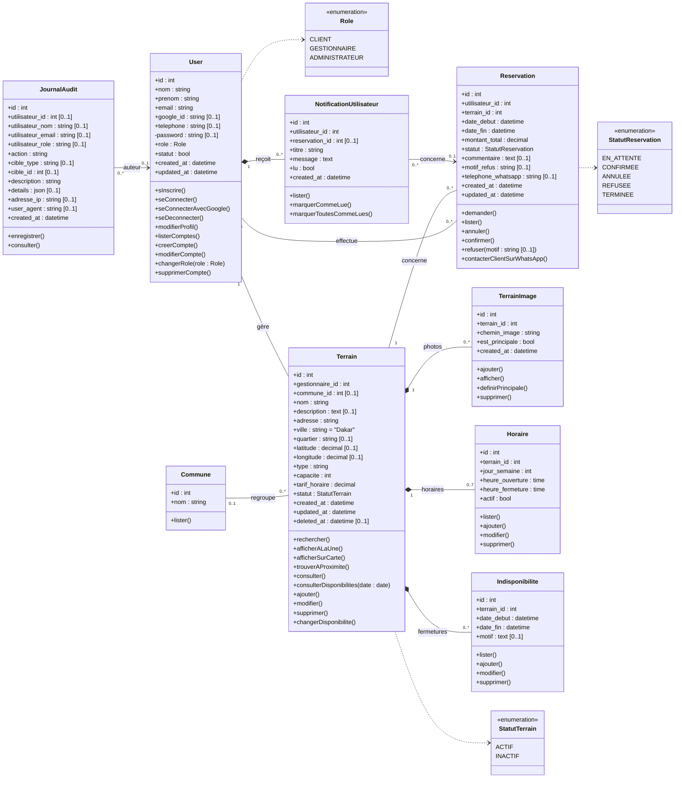
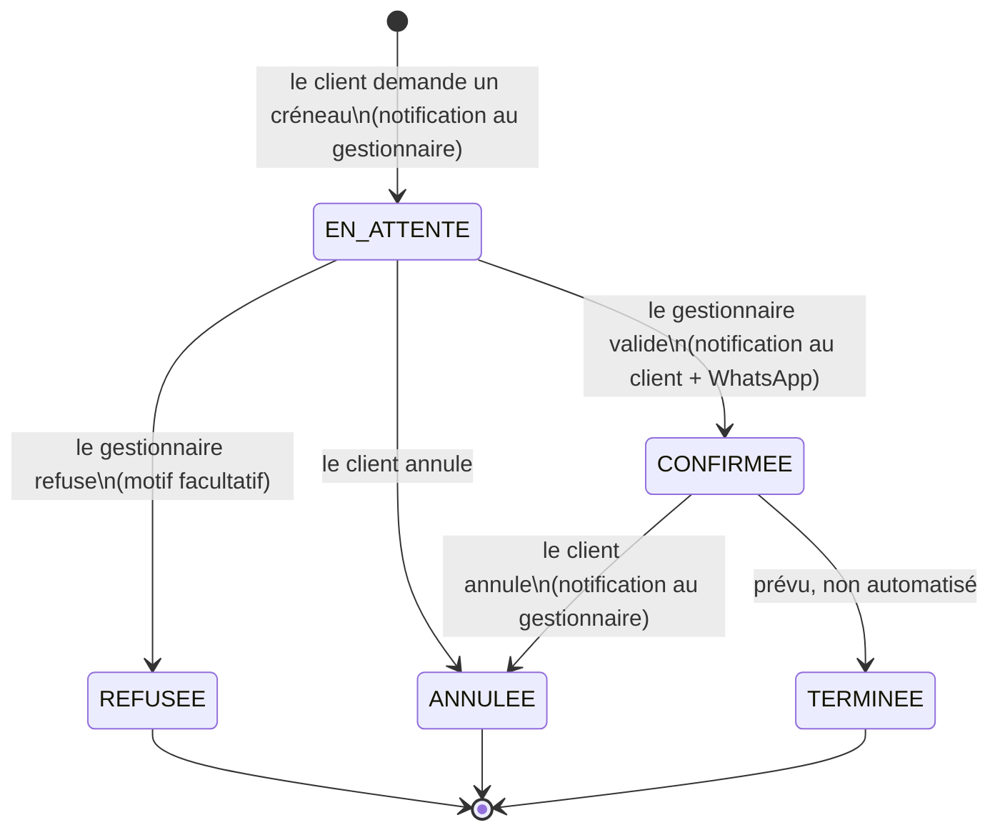

# Diagrammes de classes

Diagrammes au format [Mermaid](https://mermaid.js.org/) : ils s'affichent directement sur GitHub et dans VS Code (extension *Markdown Preview Mermaid Support*).

**Version draw.io** : [diagrammes/gestion-de-terrain.drawio](diagrammes/gestion-de-terrain.drawio), un seul fichier de 9 pages : classes, architecture, cycle de réservation, cas d'utilisation (vue générale + une page par acteur) et diagrammes de séquence (gestion d'un terrain, réservation) ; on change de page avec les onglets en bas de l'éditeur. Ouvrez-le avec draw.io Desktop, l'extension VS Code *Draw.io Integration* ou [app.diagrams.net](https://app.diagrams.net) (*Fichier → Ouvrir*). Exports prêts à l'emploi :

| Page | PNG | SVG |
| --- | --- | --- |
| 1. Diagramme de classes | [PNG](diagrammes/1-modele-de-domaine.png) | [SVG](diagrammes/1-modele-de-domaine.svg) |
| 2. Architecture backend | [PNG](diagrammes/2-architecture-backend.png) | [SVG](diagrammes/2-architecture-backend.svg) |
| 3. Cycle de réservation | [PNG](diagrammes/3-cycle-de-reservation.png) | [SVG](diagrammes/3-cycle-de-reservation.svg) |
| 4. Cas d'utilisation — vue générale | [PNG](diagrammes/4-cas-d-utilisation-general.png) | [SVG](diagrammes/4-cas-d-utilisation-general.svg) |
| 5. Cas d'utilisation — Client | [PNG](diagrammes/5-cas-d-utilisation-client.png) | [SVG](diagrammes/5-cas-d-utilisation-client.svg) |
| 6. Cas d'utilisation — Gestionnaire | [PNG](diagrammes/6-cas-d-utilisation-gestionnaire.png) | [SVG](diagrammes/6-cas-d-utilisation-gestionnaire.svg) |
| 7. Cas d'utilisation — Administrateur | [PNG](diagrammes/7-cas-d-utilisation-administrateur.png) | [SVG](diagrammes/7-cas-d-utilisation-administrateur.svg) |
| 8. Séquence — gestion d'un terrain | [PNG](diagrammes/8-sequence-gestion-d-un-terrain.png) | [SVG](diagrammes/8-sequence-gestion-d-un-terrain.svg) |
| 9. Séquence — réservation | [PNG](diagrammes/9-sequence-reservation.png) | [SVG](diagrammes/9-sequence-reservation.svg) |

Après une modification dans draw.io, réexportez les images via *Fichier → Exporter en → PNG / SVG*.

- [1. Modèle de domaine](#1-modèle-de-domaine) — les entités Eloquent, leurs attributs et leurs relations.
- [2. Architecture du backend](#2-architecture-du-backend) — contrôleurs, validations, policies et services.
- [3. Cycle de vie d'une réservation](#3-cycle-de-vie-dune-réservation).

## 1. Modèle de domaine

Chaque classe correspond à un modèle de `backend/app/Models` (table entre parenthèses dans la description ci-dessous). Les attributs suivis de `?` sont facultatifs (nullable).

### Lecture du diagramme

| Classe (table) | Rôle |
| --- | --- |
| `User` (`users`) | Compte. Le `role` détermine l'espace (client, gestionnaire, administrateur) ; `statut = false` désactive le compte. `google_id` relie un client à son compte Google ; `password` est vide pour un client inscrit avec Google. |
| `Commune` (`communes`) | Les 19 communes de Dakar, chargées par `CommuneSeeder`. |
| `Terrain` (`terrains`) | Terrain d'un gestionnaire, géolocalisé dans Dakar. Suppression douce (`deleted_at`) pour garder l'historique des réservations. |
| `TerrainImage` (`terrain_images`) | Photos ; une seule `est_principale` par terrain. |
| `Horaire` (`horaires`) | Une ligne par jour ouvert (`jour_semaine` 1 = lundi … 7 = dimanche, unique par terrain). |
| `Indisponibilite` (`indisponibilites`) | Fermeture ponctuelle (travaux, tournoi…) ; aucune réservation possible sur la période. |
| `Reservation` (`reservations`) | Demande d'un client. Le paiement ne passe pas par l'application : `telephone_whatsapp` sert au gestionnaire pour convenir du règlement. `motif_refus` conserve le motif d'un refus, affiché au client. |
| `NotificationUtilisateur` (`notifications`) | Notification affichée dans la cloche, liée à la réservation concernée. |
| `JournalAudit` (`journal_audit`) | Journal d'audit : auteur (identité recopiée), action, cible, valeurs avant / après, adresse IP. Entrées immuables, consultées par l'administrateur. |

Le champ `type` d'un terrain décrit son **revêtement** (gazon synthétique, gazon naturel…) : l'application est dédiée aux terrains de football.

- **Composition** (losange plein) : photos, horaires et fermetures n'existent pas sans leur terrain (suppression en cascade).
- **Disponibilité calculée** : `Terrain::disponibilite()` renvoie `DISPONIBLE`, `INDISPONIBLE` (fermeture en cours, avec date de fin et motif) ou `HORS_LIGNE` (terrain `INACTIF`).
- **Règle de visibilité** : `scopeVisiblesPour()` / `estVisiblePour()` limitent un gestionnaire à ses propres terrains sur les pages publiques (sauf l'accueil).

## 2. Architecture du backend

Une requête traverse : route → middleware (`auth:sanctum`, `active`, `role`) → *Form Request* (validation + autorisation) → contrôleur → policy / modèle / service → ressource JSON.

```mermaid
classDiagram
    direction TB

    namespace Middleware {
        class EnsureUserIsActive {
            +handle(Request, Closure) Response
        }
        class EnsureUserHasRole {
            +handle(Request, Closure, roles) Response
        }
    }

    namespace Controleurs {
        class AuthController {
            +register()
            +login()
            +google()
            +user()
            +updateProfile()
            +logout()
        }
        class TerrainController {
            +index()
            +featured()
            +map()
            +nearby()
            +show()
            +managedIndex()
            +managedShow()
            +store()
            +update()
            +destroy()
        }
        class TerrainAvailabilityController {
            +show()
            +update()
        }
        class TerrainImageController {
            +store()
            +setPrimary()
            +destroy()
            +show()
        }
        class TerrainPlanningController {
            +horaires()
            +storeHoraire()
            +updateHoraire()
            +destroyHoraire()
            +indisponibilites()
            +storeIndisponibilite()
            +updateIndisponibilite()
            +destroyIndisponibilite()
        }
        class ClientReservationController {
            +index()
            +store()
            +cancel()
        }
        class GestionnaireReservationController {
            +index()
            +confirm()
            +refuse()
        }
        class GeocodeController {
            +search()
            +reverse()
        }
        class NotificationUtilisateurController {
            +index()
            +markAsRead()
            +markAllAsRead()
        }
        class UserRoleController {
            +index()
            +store()
            +edit()
            +update()
            +destroy()
        }
        class JournalAuditController {
            +index()
        }
        class LogController {
            +index()
        }
    }

    namespace Regles {
        class TerrainPolicy {
            +create(User) bool
            +update(User, Terrain) bool
            +delete(User, Terrain) bool
        }
        class ReservationPolicy {
            +cancel(User, Reservation) bool
            +manage(User, Reservation) bool
        }
    }

    namespace Services {
        class NominatimGeocoder {
            +search(adresse, quartier, ville, complement, commune) array
            +searchText(text) array
            +reverse(latitude, longitude) array
        }
        class PhoneNumber {
            +toWhatsApp(number)$ string
            +isValid(number)$ bool
        }
        class DakarBounds {
            +contains(latitude, longitude)$ bool
        }
        class PublicViewer {
            +from(Request)$ User
        }
    }

    namespace Ressources {
        class TerrainResource
        class TerrainImageResource
        class ManagedReservationResource
    }

    TerrainController ..> TerrainPolicy : autorise
    TerrainController ..> PublicViewer : règle de visibilité
    TerrainController ..> TerrainResource : renvoie
    TerrainAvailabilityController ..> PublicViewer
    TerrainImageController ..> TerrainPolicy
    TerrainPlanningController ..> TerrainPolicy
    ClientReservationController ..> ReservationPolicy
    ClientReservationController ..> PhoneNumber : normalise le n° WhatsApp
    GestionnaireReservationController ..> ReservationPolicy
    GestionnaireReservationController ..> ManagedReservationResource : lien wa.me
    ManagedReservationResource ..> PhoneNumber
    GeocodeController ..> NominatimGeocoder
    NominatimGeocoder ..> DakarBounds : filtre les résultats
    TerrainResource ..> TerrainImageResource
```

Les *Form Requests* (`app/Http/Requests`) ne figurent pas sur le schéma pour le garder lisible : chacune valide les données d'une action et appelle la policy correspondante dans `authorize()` (ex. `StoreTerrainRequest` → `TerrainPolicy::create`, `StoreReservationRequest` → client actif + numéro WhatsApp valide).

## 3. Cycle de vie d'une réservation

- Une demande ne peut être **confirmée** que si son créneau n'est pas encore passé.
- **`TERMINEE`** existe dans le schéma de la base, mais aucun traitement ne la pose encore : une réservation confirmée dont le créneau est passé reste `CONFIRMEE` ; les écrans la classent dans l'historique d'après sa date.

Le paiement n'apparaît pas dans ce cycle : après la validation, le gestionnaire et le client conviennent du règlement sur WhatsApp (Wave, Orange Money, espèces…), en dehors de l'application.
